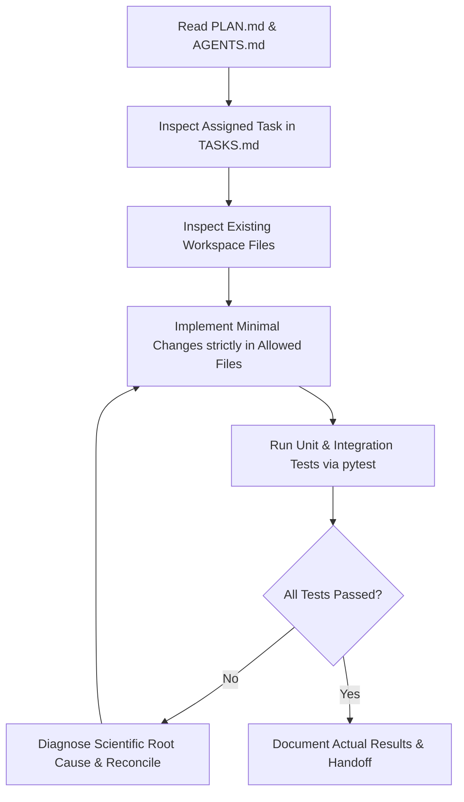

# QuantumRoute — Agent & Contributor Operating Rules (`AGENTS.md`)

**Document Status:** Baseline Governance  
**Authority:** Derived directly from [PLAN.md](file:///d:/QiskitFallFest/PLAN.md) (Source of Truth)  
**Applicability:** Mandatory for every human team member, AI coding agent, and subagent.

---

## 1. Prime Directives

1. **`PLAN.md` is the Source of Truth:** Every contributor and AI agent must read [PLAN.md](file:///d:/QiskitFallFest/PLAN.md) before proposing, changing, or implementing project work. When instructions, prompts, or snippets conflict with `PLAN.md`, do not guess or silently choose one: report the conflict immediately to the team lead.
2. **Never Fabricate:** Never invent test results, benchmarks, execution logs, hardware runs, package versions, repository URLs, or permissions. Never claim tests passed unless they were executed in the environment and their output was verified.
3. **Preserve Scientific Invariants:** Never alter mathematical equations, noise parameters, expected values, or scientific definitions to force a test to pass.
4. **Scope Discipline:** Work strictly on the assigned task and named files. Do not perform speculative refactoring, implement unassigned features, or add unapproved dependencies.
5. **Inspect Before Modifying:** Always inspect existing repository files before editing. Never overwrite or delete existing work without understanding and preserving its contents.
6. **Repository & Git Safety:** The official repository is owned by the hackathon organizers. Do not initialize alternative repositories, push to personal remotes, alter Git configurations, or switch branches without explicit human confirmation. Never commit secrets, credentials, or personal data.

---

## 2. Mandatory Scientific & Terminology Rules

To prevent conceptual errors common in quantum communication projects, all contributors must observe these strict distinctions:

- **Graph Path:** A classical graph abstraction representing connected nodes and links in a network topology.
- **Entanglement Link:** In this MVP, an abstract resource supplying a noisy Bell pair ($\rho_W$). It is **not** a physical model of optical fiber attenuation, photon absorption, or detector jitter.
- **Entanglement Swapping:** An intermediate Bell-state measurement operation that combines shared Bell pairs across repeater nodes to generate end-to-end entanglement.
- **Teleportation:** Consumes an end-to-end entangled Bell pair (plus 2 classical bits) to transfer an unknown quantum state.
- **No Repeated Teleportation:** A multi-hop connection in this project models **entanglement distribution and swapping followed by a single teleportation**, *not* hop-by-hop teleportation and reconstruction.
- **Simulation vs. Reality:** Results are numerical simulations of an abstract mathematical model using Qiskit Aer. Never claim to have demonstrated a real quantum internet or physical quantum advantage.
- **Exact vs. Finite-Shot:** Exact density-matrix simulation has numerical precision limits but zero sampling noise. Finite-shot simulation has statistical shot noise. Do not conflate the two.
- **Never Multiply Fidelities Directly:** In the Werner-link model, end-to-end Werner parameters multiply ($w_{\text{path}} = \prod w_e$), **not** the state fidelities ($F_e$). Multiplying $F_e$ directly is scientifically invalid.

---

## 3. Mandatory Mathematical Model (Source: `PLAN.md` §5)

### 3.1 Werner-Link Representation
Each network edge $e \in E$ provides a two-qubit Werner state:
$$\rho_W(w) = w |\Phi^+\rangle\langle\Phi^+| + (1 - w) \frac{I_4}{4}, \quad w \in [0, 1]$$

Its Bell-state fidelity relative to $|\Phi^+\rangle = \frac{|00\rangle + |11\rangle}{\sqrt{2}}$ is:
$$F_e = \frac{1 + 3w}{4}$$

### 3.2 Path Composition Under MVP Assumptions
Under the MVP assumptions (Werner-form links, ideal swapping, ideal classical feedforward, no memory decoherence):
$$w_{\text{path}} = \prod_{e \in P} w_e$$
$$F_{e,\text{path}} = \frac{1 + 3w_{\text{path}}}{4}$$

The resulting average single-qubit teleportation fidelity is:
$$F_{\text{tel,avg}} = \frac{2 F_{e,\text{path}} + 1}{3}$$

### 3.3 Routing Formulation
For paths with $w_e > 0$, maximizing $\prod_{e \in P} w_e$ is mathematically equivalent to minimizing:
$$\sum_{e \in P} -\ln(w_e)$$
Quality-aware routing must use Dijkstra's algorithm with edge cost $c_e = -\ln(w_e)$. If $w_e = 0$, the edge has zero entanglement and must be treated as unusable (excluded from the graph).

---

## 4. AI Agent Operating Protocol

Before any code modification, every AI agent must execute this workflow:

### 4.1 Pre-Task Specification Template
Before beginning implementation, an agent must declare:
- **Task ID & Title:** (e.g., `QR-001: Teleportation Circuit`)
- **Assigned Owner:** (Team Member or Agent)
- **Goal:** Specific outcome
- **Allowed Files:** Exact file paths permitted for modification
- **Dependencies / Interfaces:** Upstream modules or definitions
- **Acceptance Criteria:** Verifiable conditions
- **Verification Commands:** Exact commands to execute

### 4.2 Completion Handoff Template
Upon finishing, the agent must output:
- **Files Changed:** Exact list of created or modified files
- **Implementation Summary:** Brief rationale and non-obvious design choices
- **Commands Executed:** Shell commands actually run in the environment
- **Actual Test Results:** Verifiable test output (exit codes, passed counts)
- **Known Limitations & Assumptions:** Documented edge cases or constraints
- **Next Recommended Task:** The immediate downstream task ID

---

## 5. Decision & Conflict Escalation Procedure

If an agent or contributor encounters an ambiguity, missing requirement, or apparent contradiction:
1. **Stop immediately.** Do not invent a resolution.
2. Check [PLAN.md](file:///d:/QiskitFallFest/PLAN.md) §18 (Source-of-truth priority order).
3. If still unresolved, record the issue in [DECISIONS.md](file:///d:/QiskitFallFest/DECISIONS.md) as an **Open Question**.
4. Request confirmation from the human team lead before proceeding.
