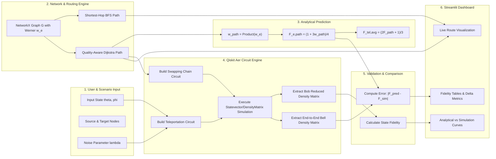

# QuantumRoute — System Architecture & Module Boundaries (`ARCHITECTURE.md`)

**Document Status:** Baseline Architecture  
**Reference Document:** [PLAN.md](file:///d:/QiskitFallFest/PLAN.md) (§8, §9)  
**Scope:** Engineering prototype for Qiskit Fall Fest 2026 (38-hour build constraint)

---

## 1. Architectural Philosophy

QuantumRoute is engineered as a **compact, simulator-first, single-process Python application**.
- **No Complex Distributed Stacks:** No FastAPI backend, no Node.js/React frontend, no external databases, and no containerized microservices.
- **Single Source of Truth:** All numerical simulations, quantum circuits, and graph calculations are executed by core Python modules in `src/quantumroute/`.
- **Zero Logic Duplication in UI:** The Streamlit dashboard (`app/streamlit_app.py`) serves solely as a presentation layer; it directly imports and executes the tested modules from `src/quantumroute/`.

---

## 2. Target Directory & Module Structure

```text
quantumroute/
├── PLAN.md                    # Primary source of truth and master plan
├── AGENTS.md                  # Contributor & AI agent governance rules
├── ARCHITECTURE.md            # System architecture and data flow contracts
├── DECISIONS.md               # Architecture decision records and open questions
├── TASKS.md                   # Granular task breakdown and dependencies
├── TESTING.md                 # Scientific invariants and verification suite
├── README.md                  # Overview, setup, and execution guide
├── .gitignore                 # Python, virtualenv, and IDE exclusions
├── requirements.txt           # Environment dependencies
├── src/
│   └── quantumroute/
│       ├── __init__.py        # Package initialization and exports
│       ├── teleport.py        # Input state preparation, 3-qubit teleportation, fidelity
│       ├── experiments.py     # Parameter sweeps (depolarizing noise), seed management
│       ├── network.py         # NetworkX topology, Werner parameters, path calculation
│       ├── routing.py         # Shortest-hop (BFS) and Quality-aware (Dijkstra) routing
│       ├── swapping.py        # Circuit-level entanglement swapping across repeater chains
│       └── validate.py        # Predicted vs. simulated validation harness
├── tests/
│   ├── test_teleport.py       # Teleportation state fidelity and normalization tests
│   ├── test_noise.py          # Depolarizing channel fidelity vs. analytical theory
│   ├── test_network.py        # Graph integrity and Werner parameter constraints
│   ├── test_routing.py        # Path validity, edge cases, Dijkstra vs. BFS comparisons
│   └── test_validation.py     # Predicted vs. circuit-simulated swapping validation
├── app/
│   └── streamlit_app.py       # Interactive UI for routing, noise sweeps, and demo
└── results/
    └── .gitkeep               # Directory for exported figures and numerical logs
```

---

## 3. Module Responsibilities & Interfaces

### 3.1 `src/quantumroute/teleport.py` (Quantum Core)
- **Responsibility:** Implements single-link teleportation on a 3-qubit register (`q0` message, `q1` Alice's Bell qubit, `q2` Bob's Bell qubit).
- **Core Functions:**
  - `prepare_input_state(theta, phi) -> Statevector`: Deterministically prepares arbitrary single-qubit states.
  - `create_bell_pair() -> QuantumCircuit`: Prepares the canonical $|\Phi^+\rangle = (|00\rangle + |11\rangle)/\sqrt{2}$ Bell pair.
  - `build_teleportation_circuit(state, noise_channel=None) -> QuantumCircuit`: Constructs the complete teleportation protocol.
  - `extract_bob_density_matrix(circuit) -> DensityMatrix`: Uses Qiskit Aer statevector/density-matrix simulation to extract Bob's reduced state after coherent feedforward corrections (`cx`, `cz`).
  - `calculate_state_fidelity(rho_target, rho_actual) -> float`: Computes state fidelity using `qiskit.quantum_info.state_fidelity`.

### 3.2 `src/quantumroute/experiments.py` (Noise & Sweeps)
- **Responsibility:** Executes reproducible sweeps over noise parameters using fixed random seeds.
- **Core Functions:**
  - `depolarizing_noise_sweep(param_range, input_states, seed=42) -> dict`: Computes output fidelities across a grid of depolarizing probabilities $\lambda \in [0, 1]$.
  - `get_analytical_depolarizing_fidelity(lambda_param, input_state) -> float`: Evaluates the closed-form theoretical fidelity for direct comparison.

### 3.3 `src/quantumroute/network.py` (Network Graph & Werner Model)
- **Responsibility:** Encapsulates the abstract quantum network graph using `networkx.Graph`.
- **Core Functions:**
  - `create_topology() -> nx.Graph`: Builds a standard 6–8 node test network where nodes represent repeaters/endpoints and edges carry Werner parameters $w_e \in (0, 1]$.
  - `calculate_path_werner_parameter(graph, path) -> float`: Computes $w_{\text{path}} = \prod_{e \in P} w_e$.
  - `calculate_predicted_path_fidelity(w_path) -> float`: Computes $F_{e,\text{path}} = \frac{1 + 3w_{\text{path}}}{4}$.
  - `calculate_average_teleportation_fidelity(F_path) -> float`: Computes $F_{\text{tel,avg}} = \frac{2 F_{e,\text{path}} + 1}{3}$.

### 3.4 `src/quantumroute/routing.py` (Routing Algorithms)
- **Responsibility:** Determines paths through the network graph.
- **Core Functions:**
  - `find_shortest_hop_route(graph, source, target) -> list`: BFS-based baseline minimizing total hop count.
  - `find_quality_aware_route(graph, source, target) -> list`: Dijkstra algorithm using additive edge weights $c_e = -\ln(w_e)$, maximizing end-to-end Werner parameter.
  - Validates that $w_e \in (0, 1]$; handles disconnected nodes and zero-entanglement links ($w_e = 0$) by marking them unusable.

### 3.5 `src/quantumroute/swapping.py` (Entanglement Swapping Circuit)
- **Responsibility:** Implements quantum circuit simulation of entanglement swapping across multi-hop repeater chains.
- **Core Functions:**
  - `build_swapping_chain_circuit(chain_werner_parameters) -> QuantumCircuit`: Prepares Bell pairs on adjacent link registers and applies intermediate Bell-basis measurements and coherent corrections.
  - `simulate_end_to_end_bell_state(circuit) -> DensityMatrix`: Evaluates the 2-qubit reduced density matrix of the end nodes.

### 3.6 `src/quantumroute/validate.py` (Verification Harness)
- **Responsibility:** Bridges analytical network predictions with circuit simulations.
- **Core Functions:**
  - `compare_predicted_vs_simulated(graph, path) -> dict`: Evaluates the analytical $F_{e,\text{path}}$ vs. circuit-simulated $F_{\text{circuit}}$ and returns absolute delta, relative error, and pass/fail against defined numerical tolerances ($\epsilon \le 10^{-5}$).

### 3.7 `app/streamlit_app.py` (Dashboard Presentation)
- **Responsibility:** Interactive UI for demonstrators, judges, and users.
- **Sections:**
  - **Overview & Assumptions:** States problem, Werner model, and simulator scope.
  - **Single-Link Teleportation:** Interactive Bloch sphere / state selection, ideal circuit run, measured fidelity.
  - **Noise Channel Sweep:** Depolarizing noise slider, live curve comparing simulation with analytical formula.
  - **Network Topology & Route Selection:** Visual graph highlighting Shortest-Hop (BFS) vs. Quality-Aware (Dijkstra) paths.
  - **Validation Summary:** Comparison table showing predicted vs. circuit-simulated fidelity and model error.

---

## 4. End-to-End Data Flow



---

## 5. Architectural Boundaries & Non-Goals

1. **Simulator Only:** No physical hardware integration, IBM Quantum cloud credentials, or hardware backends.
2. **Abstract Werner Links:** No optical fiber dispersion, photon loss, detector dark counts, or memory coherence degradation models.
3. **No Dynamic Mid-Circuit Measurement Required for MVP:** Initial circuit uses coherent feedforward (`cx`, `cz`) for simulation equivalence to ensure robust execution across local Aer simulator backends.
4. **No Hop-by-Hop Teleportation:** Teleportation occurs solely across the end-to-end established Bell pair.
5. **No Databases or Auth:** All network configurations and experiment states exist ephemerally in Python runtime memory.
