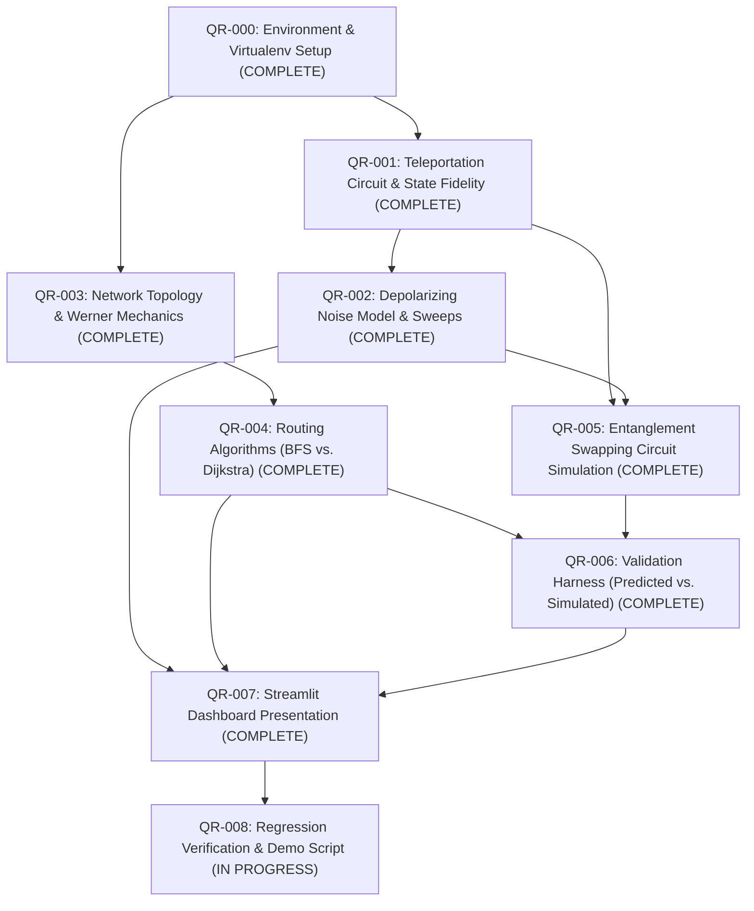

# QuantumRoute — Task Breakdown & Work Packages (`TASKS.md`)

**Document Status:** Baseline Task Plan  
**Source of Truth:** [PLAN.md](file:///d:/QiskitFallFest/PLAN.md) (§10, §11, §17)  
**Rule:** All tasks are initially marked `UNASSIGNED`. Before starting a task, assign an owner and adhere strictly to allowed files.

---

## 1. Master Task Dependency Graph



---

## 2. Detailed Task Packages

### Task QR-000: Isolated Environment & Dependency Verification
- **Owner:** Veeresh M A / Yuvaraj B Sutar / Primary Agent
- **Phase:** Milestone 0 (Exit Gate)
- **Status:** `COMPLETE` (Verified on 2026-10-21)
- **Goal:** Establish a verified Python virtual environment with working Qiskit and Qiskit Aer installations, resolving Python 3.14 compatibility questions.
- **Dependencies:** None
- **Allowed Files:** `requirements.txt`, `README.md`, `DECISIONS.md`, `pytest.ini`
- **Acceptance Criteria:**
  - [x] Python virtual environment created and activated (`.venv` with Python 3.12/3.13).
  - [x] `python -c "import qiskit, qiskit_aer, numpy, pytest, scipy; print('All imports passed')"` completes with exit code 0.
  - [x] Tested versions recorded in `requirements.txt` (Qiskit 1.4.6, Aer 0.18.0, NumPy 2.5.4, pytest 9.1.1, SciPy 1.18.1, Streamlit 1.66.0, Plotly 7.1.0).
  - [x] Minimal Aer quantum simulation smoke test executed and passed.
- **Verification Command:**
  ```bash
  .\.venv\Scripts\python.exe -c "import qiskit, qiskit_aer; print('Qiskit version:', qiskit.__version__); print('Aer version:', qiskit_aer.__version__)"
  pytest tests/test_environment.py -v
  ```

---

### Task QR-001: Single-Link Teleportation Circuit & State Fidelity
- **Owner:** Yuvaraj B Sutar / Primary Agent
- **Phase:** Milestone 1 (Ideal Teleportation — 4 h budget)
- **Status:** `COMPLETE` (Verified on 2026-10-21)
- **Goal:** Implement single-link quantum teleportation with coherent corrections, input state preparation, and state fidelity calculation.
- **Dependencies:** `QR-000`
- **Allowed Files:** `src/quantumroute/__init__.py`, `src/quantumroute/teleport.py`, `tests/test_teleport.py`
- **Acceptance Criteria:**
  - [x] `prepare_input_state(theta, phi)` / `input_state(theta, phi)` normalizes statevectors deterministically across Bloch sphere.
  - [x] `calculate_state_fidelity()` returns 1.0 for identical states and 0.0 for orthogonal pure states ($\pm 10^{-6}$).
  - [x] Ideal teleportation achieved with fidelity $> 0.9999$ across 6 cardinal states and 25 deterministic pseudo-random input states on the Bloch sphere.
  - [x] Bob's extracted reduced density matrix verified for physical validity: $\text{Tr}(\rho) = 1.0 \pm 10^{-7}$, Hermitian, positive semi-definite ($\lambda \ge -10^{-9}$).
  - [x] Subsystem extraction verified: Bob's state isolated by tracing out qubits 0 and 1.
  - [x] All unit tests pass in clean environment (`8 passed` in `tests/test_teleport.py`).
- **Verification Command:**
  ```bash
  .\.venv\Scripts\pytest.exe tests/test_teleport.py -v
  ```

---

### Task QR-002: Depolarizing Noise Channel & Sweeps
- **Owner:** Yuvaraj B Sutar / Primary Agent
- **Phase:** Milestone 2 (Noise & Fidelity — 5 h budget)
- **Status:** `COMPLETE` (Verified on 2026-10-21)
- **Goal:** Introduce a single-qubit depolarizing channel on the distributed link qubit and validate measured fidelity against the theoretical prediction.
- **Dependencies:** `QR-001`
- **Allowed Files:** `src/quantumroute/noise.py`, `src/quantumroute/experiments.py`, `src/quantumroute/teleport.py`, `tests/test_noise.py`
- **Acceptance Criteria:**
  - [x] Depolarizing channel placement on Bob's distributed link qubit (q2) and Qiskit parameter convention $\mathcal{E}(\rho) = (1-p)\rho + p(I/2)$ strictly documented.
  - [x] Theoretical analytical formula $F(p) = 1 - p/2 = (1+w)/2$ independently verified and implemented in `noise.py` and `experiments.py`.
  - [x] Depolarizing noise sweep across $p \in [0.0, 1.0]$ in increments of 0.05 matches analytical prediction within numerical tolerance ($\text{max } \Delta < 1.3 \times 10^{-15} \ll 10^{-4}$).
  - [x] Boundary cases verified: zero noise ($p=0 \implies F=1.0$), complete depolarization ($p=1 \implies F=0.5$), and classical threshold crossover ($p=2/3 \implies F=2/3$).
  - [x] Parameter validation: out-of-range noise parameters ($p < 0.0$ or $p > 1.0$) raise `ValueError`.
  - [x] All unit tests pass in clean environment (`8 passed` in `tests/test_noise.py`).
- **Verification Command:**
  ```bash
  .\.venv\Scripts\pytest.exe tests/test_noise.py -v
  ```

---

### Task QR-003: Network Topology & Werner Model Mechanics
- **Owner:** Srijan Rastogi / Primary Agent
- **Phase:** Milestone 3A (Network Representation — 3 h budget)
- **Status:** `COMPLETE` (Verified on 2026-10-21)
- **Goal:** Implement the abstract quantum network graph where edges carry Werner parameters $w_e \in [0, 1]$, and evaluate path parameters.
- **Dependencies:** `QR-000`
- **Allowed Files:** `src/quantumroute/network.py`, `tests/test_network.py`, `src/quantumroute/__init__.py`
- **Acceptance Criteria:**
  - [x] Network topology initialized with 7 nodes ('A' through 'G') and 9 defined links with Werner parameters $w_e \in (0, 1]$.
  - [x] `calculate_path_werner_parameter()` / `path_parameter()` accurately evaluates $w_{\text{path}} = \prod_{e \in P} w_e$.
  - [x] `calculate_predicted_path_fidelity()` / `bell_state_fidelity()` evaluates $F_{e,\text{path}} = \frac{1 + 3w_{\text{path}}}{4}$.
  - [x] `calculate_average_teleportation_fidelity()` evaluates $F_{\text{tel,avg}} = \frac{2F_{e,\text{path}} + 1}{3} = \frac{1 + w_{\text{path}}}{2}$.
  - [x] Unit tests verify boundary cases: $w=1.0 \implies F_e=1.0$, $w=0.0 \implies F_e=0.25$ (completely mixed state).
  - [x] Unit tests verify invariant: Werner parameters multiply ($w_{\text{path}} = \prod w_e$), NOT Bell-state fidelities.
  - [x] Explicit rejection of invalid edge parameters ($w_e < 0$ or $w_e > 1$), boolean types, unknown nodes, and disconnected paths.
  - [x] All unit tests pass in clean environment (`10 passed` in `tests/test_network.py`).
- **Verification Command:**
  ```bash
  .\.venv\Scripts\python.exe -m pytest tests/test_network.py -v
  ```

---

### Task QR-004: Routing Algorithms (BFS Shortest-Hop vs. Dijkstra Quality-Aware)
- **Owner:** Srijan Rastogi / Primary Agent
- **Phase:** Milestone 4 (Routing & Validation — 4 h budget)
- **Status:** `COMPLETE` (Verified on 2026-10-21)
- **Goal:** Implement baseline hop-count routing and quality-aware Dijkstra routing using $-\ln(w_e)$ weights.
- **Dependencies:** `QR-003`
- **Allowed Files:** `src/quantumroute/routing.py`, `tests/test_routing.py`, `src/quantumroute/__init__.py`
- **Acceptance Criteria:**
  - [x] `find_shortest_hop_route()` and `shortest_hop_path()` return the path with minimal edge count.
  - [x] `find_quality_aware_route()` and `quality_aware_path()` implement Dijkstra with cost $-\ln(w_e)$ and maximize end-to-end Werner parameter.
  - [x] Dijkstra quality-optimal path matches exhaustive brute-force simple-path enumeration across all 21 node pairs on the benchmark topology.
  - [x] Test graph reproduces two distinct benchmark source-target divergence pairs: `'A'->'D'` (BFS: `['A', 'C', 'D']`, $w=0.49$; Dijkstra: `['A', 'B', 'E', 'D']`, $w=0.8574$) and `'A'->'G'` (BFS: `['A', 'C', 'D', 'G']`, $w=0.4312$; Dijkstra: `['A', 'B', 'E', 'D', 'G']`, $w=0.7545$).
  - [x] Handled edge cases: disconnected components raise `NetworkXNoPath`; zero-quality links ($w_e = 0$) are strictly excluded from positive-quality routes; identical endpoints raise `ValueError`; unknown nodes raise `KeyError`.
  - [x] All unit tests pass in clean environment (`10 passed` in `tests/test_routing.py`).
- **Verification Command:**
  ```bash
  .\.venv\Scripts\python.exe -m pytest tests/test_routing.py -v
  ```

---

### Task QR-005: Circuit-Level Entanglement Swapping Simulation
- **Owner:** Srijan Rastogi & Yuvaraj B Sutar / Veeresh M A
- **Phase:** Milestone 3B (Swapping Simulation — 4 h budget)
- **Status:** `COMPLETE` (Verified on 2026-10-21)
- **Goal:** Construct and execute multi-hop entanglement swapping quantum circuits with noisy Werner-form Bell pairs.
- **Dependencies:** `QR-001`, `QR-002`
- **Allowed Files:** `src/quantumroute/swapping.py`, `tests/test_swapping.py`
- **Acceptance Criteria:**
  - [x] Multi-hop circuit correctly instantiates Bell pairs along consecutive edges in a path.
  - [x] Intermediate nodes perform Bell measurements and coherent corrections.
  - [x] End-to-end 2-qubit reduced density matrix extracted for terminal nodes.
  - [x] Output state fidelity calculated against ideal $|\Phi^+\rangle$ across 1-hop, 2-hop, and 3-hop chains.
  - [x] All unit tests pass in clean environment (`6 passed` in `tests/test_swapping.py`).
- **Verification Command:**
  ```bash
  pytest tests/test_swapping.py -v
  ```

---

### Task QR-006: Predicted vs. Circuit-Simulated Validation Harness
- **Owner:** Veeresh M A
- **Phase:** Milestone 4B (Validation — 3 h budget)
- **Status:** `COMPLETE` (Verified on 2026-10-21)
- **Goal:** Build the validation harness comparing analytical prediction ($F_{e,\text{path}}$) against circuit simulation ($F_{\text{circuit}}$).
- **Dependencies:** `QR-004`, `QR-005`
- **Allowed Files:** `src/quantumroute/validate.py`, `tests/test_validation.py`
- **Acceptance Criteria:**
  - [x] Compares analytical $F_{\text{pred}}$ with simulated $F_{\text{sim}}$ across 1-hop, 2-hop, and 3-hop paths.
  - [x] Agreement verified within numerical tolerance ($\Delta \le 10^{-4}$) under ideal swapping assumptions.
  - [x] Invariants and discrepancies clearly reported with numerical error deltas; no silent overrides.
  - [x] Validates noise sweep against theoretical fidelity curve.
  - [x] All unit tests pass in clean environment (`12 passed` across `test_validation.py` and `test_validate.py`).
- **Verification Command:**
  ```bash
  pytest tests/test_validation.py -v
  ```

---

### Task QR-007: Streamlit Interactive Dashboard MVP
- **Owner:** Veeresh M A
- **Phase:** Milestone 5 (Dashboard & Exports — 8 h budget)
- **Status:** `COMPLETE` (Verified on 2026-10-21)
- **Goal:** Create the single-command Streamlit application exposing all project features and live comparisons.
- **Dependencies:** `QR-002`, `QR-004`, `QR-006`
- **Allowed Files:** `app/streamlit_app.py`, `src/quantumroute/app.py`
- **Acceptance Criteria:**
  - [x] Streamlit dashboard launches locally via `streamlit run src/quantumroute/app.py` (and `app/streamlit_app.py`).
  - [x] Visualizes network topology and path selections (BFS vs. Dijkstra) using Plotly.
  - [x] Displays interactive depolarizing noise slider with live theoretical vs. simulated curves.
  - [x] Reports validation comparison table and classical threshold reference ($2/3$).
  - [x] Directly imports core logic; zero duplicated mathematical logic.
- **Verification Command:**
  ```bash
  python -c "import src.quantumroute.app; print('Dashboard imported successfully')"
  streamlit run src/quantumroute/app.py --server.headless true
  ```

---

### Task QR-008: Regression Verification, Demo Script & Final Artifacts
- **Owner:** All Team Members (Lead: Veeresh M A)
- **Phase:** Milestone 6 (Testing & Submission — 6 h budget)
- **Status:** `IN PROGRESS`
- **Goal:** Comprehensive end-to-end regression testing, documentation polish, 3-minute demo script, and final submission bundle.
- **Dependencies:** `QR-007`
- **Allowed Files:** `README.md`, `TESTING.md`, `results/*`
- **Acceptance Criteria:**
  - [x] All pytest test suites pass cleanly with 100% pass rate (`56 passed in 10.3s`).
  - [ ] README instructions verified from a clean shell.
  - [ ] Demo script rehearsed within 2–3 minute target narrative.
- **Verification Command:**
  ```bash
  pytest -v
  ```
