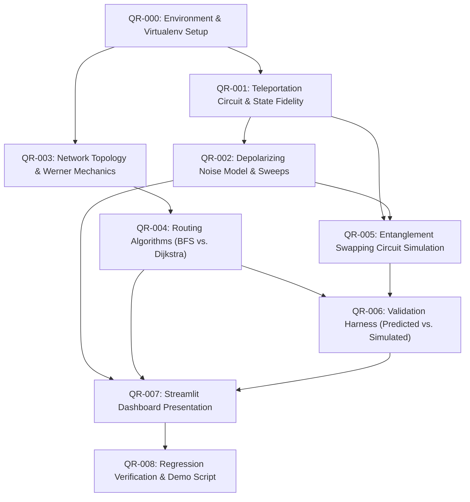

# QuantumRoute — Task Breakdown & Work Packages (`TASKS.md`)

**Document Status:** Baseline Task Plan  
**Source of Truth:** [PLAN.md](file:///d:/QiskitFallFest/PLAN.md) (§10, §11, §17)  
**Rule:** All tasks are initially marked `UNASSIGNED`. Before starting a task, assign an owner and adhere strictly to allowed files.

---

## 1. Master Task Dependency Graph



---

## 2. Detailed Task Packages

### Task QR-000: Isolated Environment & Dependency Verification
- **Owner:** `UNASSIGNED` (Proposed: Member A / Environment Lead)
- **Phase:** Milestone 0 (Exit Gate)
- **Goal:** Establish a verified Python virtual environment with working Qiskit and Qiskit Aer installations, resolving Python 3.14 compatibility questions.
- **Dependencies:** None
- **Allowed Files:** `requirements.txt`, `README.md`, `DECISIONS.md`
- **Acceptance Criteria:**
  - Python virtual environment created and activated.
  - `python -c "import qiskit, qiskit_aer, networkx, numpy, pytest, streamlit; print('All imports passed')"` completes with exit code 0.
  - Tested versions recorded in `requirements.txt`.
- **Verification Command:**
  ```bash
  python -c "import qiskit, qiskit_aer; print('Qiskit version:', qiskit.__version__)"
  ```

---

### Task QR-001: Single-Link Teleportation Circuit & State Fidelity
- **Owner:** `UNASSIGNED` (Proposed: Member A — Quantum Core)
- **Phase:** Milestone 1 (Ideal Teleportation — 4 h budget)
- **Goal:** Implement single-link quantum teleportation with coherent corrections, input state preparation, and state fidelity calculation.
- **Dependencies:** `QR-000`
- **Allowed Files:** `src/quantumroute/__init__.py`, `src/quantumroute/teleport.py`, `tests/test_teleport.py`
- **Acceptance Criteria:**
  - `prepare_input_state(theta, phi)` normalizes statevectors deterministically.
  - `calculate_state_fidelity()` returns 1.0 for identical states and 0.0 for orthogonal pure states ($\pm 10^{-6}$).
  - Ideal teleportation achieved with fidelity $> 0.9999$ across at least 20 deterministic input states on the Bloch sphere (including $|0\rangle$, $|1\rangle$, $|+\rangle$, $|-\rangle$, $|i\rangle$, $|-i\rangle$, and random parameter pairs).
  - All unit tests pass in clean environment.
- **Verification Command:**
  ```bash
  pytest tests/test_teleport.py -v
  ```

---

### Task QR-002: Depolarizing Noise Channel & Sweeps
- **Owner:** `UNASSIGNED` (Proposed: Member A — Quantum Core)
- **Phase:** Milestone 2 (Noise & Fidelity — 5 h budget)
- **Goal:** Introduce a single-qubit depolarizing channel on the distributed link qubit and validate measured fidelity against the theoretical prediction.
- **Dependencies:** `QR-001`
- **Allowed Files:** `src/quantumroute/experiments.py`, `src/quantumroute/teleport.py`, `tests/test_noise.py`
- **Acceptance Criteria:**
  - Depolarizing channel placement and parameter convention strictly documented in code.
  - Theoretical analytical formula independently verified and implemented in `experiments.py`.
  - Depolarizing noise sweep across $\lambda \in [0.0, 1.0]$ in increments of 0.05 matches analytical prediction within numerical tolerance ($\epsilon \le 10^{-4}$).
  - Parameter validation: negative or out-of-range noise parameters raise `ValueError`.
- **Verification Command:**
  ```bash
  pytest tests/test_noise.py -v
  ```

---

### Task QR-003: Network Topology & Werner Model Mechanics
- **Owner:** `UNASSIGNED` (Proposed: Member B — Network & Routing)
- **Phase:** Milestone 3A (Network Representation — 3 h budget)
- **Goal:** Implement the abstract quantum network graph where edges carry Werner parameters $w_e \in (0, 1]$, and evaluate path parameters.
- **Dependencies:** `QR-000`
- **Allowed Files:** `src/quantumroute/network.py`, `tests/test_network.py`
- **Acceptance Criteria:**
  - Network topology initialized with 6–8 nodes and defined link Werner parameters.
  - `calculate_path_werner_parameter()` accurately evaluates $w_{\text{path}} = \prod_{e \in P} w_e$.
  - `calculate_predicted_path_fidelity()` evaluates $F_{e,\text{path}} = \frac{1 + 3w_{\text{path}}}{4}$.
  - Unit tests verify boundary cases: $w=1.0 \implies F_e=1.0$, $w=0.0 \implies F_e=0.25$ (completely mixed state).
  - Explicit rejection of invalid edge parameters ($w_e < 0$ or $w_e > 1$).
- **Verification Command:**
  ```bash
  pytest tests/test_network.py -v
  ```

---

### Task QR-004: Routing Algorithms (BFS Shortest-Hop vs. Dijkstra Quality-Aware)
- **Owner:** `UNASSIGNED` (Proposed: Member B — Network & Routing)
- **Phase:** Milestone 4 (Routing & Validation — 4 h budget)
- **Goal:** Implement baseline hop-count routing and quality-aware Dijkstra routing using $-\ln(w_e)$ weights.
- **Dependencies:** `QR-003`
- **Allowed Files:** `src/quantumroute/routing.py`, `tests/test_routing.py`
- **Acceptance Criteria:**
  - `find_shortest_hop_route()` returns the path with minimal edge count.
  - `find_quality_aware_route()` implements Dijkstra with cost $-\ln(w_e)$ and maximizes end-to-end Werner parameter.
  - Test graph contains at least two distinct source-target pairs where Shortest-Hop and Quality-Aware select different paths.
  - Handled edge cases: disconnected components return informative error; edges with $w_e = 0$ are marked unusable.
- **Verification Command:**
  ```bash
  pytest tests/test_routing.py -v
  ```

---

### Task QR-005: Circuit-Level Entanglement Swapping Simulation
- **Owner:** `UNASSIGNED` (Proposed: Member A & B Joint)
- **Phase:** Milestone 3B (Swapping Simulation — 4 h budget)
- **Goal:** Construct and execute multi-hop entanglement swapping quantum circuits with noisy Werner-form Bell pairs.
- **Dependencies:** `QR-001`, `QR-002`
- **Allowed Files:** `src/quantumroute/swapping.py`, `tests/test_swapping.py`
- **Acceptance Criteria:**
  - Multi-hop circuit correctly instantiates Bell pairs along consecutive edges in a path.
  - Intermediate nodes perform Bell measurements and coherent corrections.
  - End-to-end 2-qubit reduced density matrix extracted for terminal nodes.
  - Output state fidelity calculated against ideal $|\Phi^+\rangle$.
- **Verification Command:**
  ```bash
  pytest tests/test_swapping.py -v
  ```

---

### Task QR-006: Predicted vs. Circuit-Simulated Validation Harness
- **Owner:** `UNASSIGNED` (Proposed: Member C — Validation & Interface)
- **Phase:** Milestone 4B (Validation — 3 h budget)
- **Goal:** Build the validation harness comparing analytical prediction ($F_{e,\text{path}}$) against circuit simulation ($F_{\text{circuit}}$).
- **Dependencies:** `QR-004`, `QR-005`
- **Allowed Files:** `src/quantumroute/validate.py`, `tests/test_validation.py`
- **Acceptance Criteria:**
  - Compares analytical $F_{\text{pred}}$ with simulated $F_{\text{sim}}$ across 1-hop, 2-hop, and 3-hop paths.
  - Agreement verified within numerical tolerance ($\Delta \le 10^{-4}$) under ideal swapping assumptions.
  - Invariants and discrepancies clearly reported with numerical error deltas; no silent overrides.
- **Verification Command:**
  ```bash
  pytest tests/test_validation.py -v
  ```

---

### Task QR-007: Streamlit Interactive Dashboard MVP
- **Owner:** `UNASSIGNED` (Proposed: Member C — Validation & Interface)
- **Phase:** Milestone 5 (Dashboard & Exports — 8 h budget)
- **Goal:** Create the single-command Streamlit application exposing all project features and live comparisons.
- **Dependencies:** `QR-002`, `QR-004`, `QR-006`
- **Allowed Files:** `app/streamlit_app.py`, `src/quantumroute/experiments.py`
- **Acceptance Criteria:**
  - Streamlit dashboard launches locally via `streamlit run app/streamlit_app.py`.
  - Visualizes network topology and path selections (BFS vs. Dijkstra).
  - Displays interactive depolarizing noise slider with live theoretical vs. simulated curves.
  - Reports validation comparison table and classical threshold reference ($2/3$).
  - Directly imports core logic; zero duplicated mathematical logic.
- **Verification Command:**
  ```bash
  streamlit run app/streamlit_app.py --server.headless true
  ```

---

### Task QR-008: Regression Verification, Demo Script & Final Artifacts
- **Owner:** `UNASSIGNED` (All Team Members)
- **Phase:** Milestone 6 (Testing & Submission — 6 h budget)
- **Goal:** Comprehensive end-to-end regression testing, documentation polish, 3-minute demo script, and final submission bundle.
- **Dependencies:** `QR-007`
- **Allowed Files:** `README.md`, `TESTING.md`, `results/*`
- **Acceptance Criteria:**
  - All pytest test suites pass cleanly with 100% pass rate.
  - README instructions verified from a clean shell.
  - Demo script rehearsed within 2–3 minute target narrative.
- **Verification Command:**
  ```bash
  pytest -v
  ```
