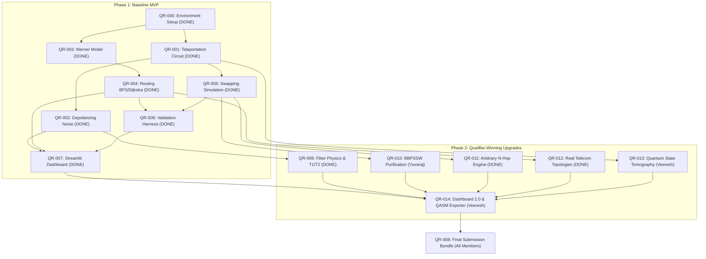

# QuantumRoute — Team Work Split (`TEAM_WORK_SPLIT.md`)

**Team:** Quantum D Clan  
**Team ID:** VTU-QFF-HC-0126  
**Status:** Active Execution (Phase 1 Baseline MVP Complete; Phase 2 Advanced Competitive Upgrades Active)

## Confirmed members

| Member | GitHub username | Role |
|---|---|---|
| Yuvaraj B Sutar | `YUVA56-gomu` | Team Lead; Quantum Circuits & Physical Noise Lead |
| Srijan Rastogi | `SrijanRastogi` | Network Topology, Dynamic Swapping & Routing Lead |
| Veeresh M A | `Veeresh23-06` | Validation, Tomography, Integration & Dashboard Lead |

---

## Project Goal
Deliver a scientifically defensible, reproducible, and competitive Qiskit simulator for noise-aware quantum communication, entanglement-based teleportation, multi-hop repeater networks, and quality-optimal routing that models real-world optical fiber physics and finite-shot quantum tomography.

---

## 👥 Task Assignments by Member

### 1. Yuvaraj B Sutar — Team Lead; Quantum Circuits & Physical Noise Lead
**Owns:** `teleport.py`, `noise.py`, `physics.py`, `purification.py`, `experiments.py`, `tests/test_teleport.py`, `tests/test_noise.py`, `tests/test_physics.py`, `tests/test_purification.py`.

**Phase 1 Tasks (Completed):**
- **`QR-001`**: Ideal single-link quantum teleportation with coherent feedforward corrections (ADR-002 deferred measurement).
- **`QR-002`**: Single-qubit depolarizing noise model on distributed Bell link ($F = 1 - p/2$).

**Phase 2 Advanced Tasks (In Progress):**
- **`QR-009`** (Completed): Physical Optical Fiber Attenuation & $T_1/T_2$ Decoherence Channel:
  - Modeled realistic silica telecom fiber attenuation ($\alpha = 0.2\text{ dB/km}$ at $1550\text{ nm}$) with transmission probability $\eta(L) = 10^{-\alpha L / 10}$.
  - Mapped fiber distance $L$ directly to link Werner parameter $w(L)$ and detector dark counts ($p_{\text{dark}}$).
  - Implemented Amplitude Damping ($T_1$) and Phase Damping ($T_2$) channels in `physics.py`, with quantum mechanical invariant bound checks ($T_2 \le 2T_1$).
  - Added 7 unit tests in `tests/test_physics.py`.
- **`QR-010`** (Completed): BBPSSW Entanglement Purification Protocol:
  - Implemented 1-step and multi-round bilateral CNOT distillation on two noisy Bell pairs:
    $$F' = \frac{F^2 + \frac{1}{9}(1-F)^2}{F^2 + \frac{2}{3}F(1-F) + \frac{5}{9}(1-F)^2}$$
  - Simulated 4-qubit bilateral CNOT circuit with $Z$-basis parity projection and partial trace in `purification.py`.
  - Verified exact match between circuit simulation and analytical theory ($\Delta \le 10^{-6}$).
  - Added 9 unit tests in `tests/test_purification.py`.

---

### 2. Srijan Rastogi — Network Topology, Dynamic Swapping & Routing Lead
**Owns:** `network.py`, `routing.py`, `swapping.py`, `tests/test_network.py`, `tests/test_routing.py`, `tests/test_swapping.py`, `tests/test_topologies.py`.

**Phase 1 Tasks (Completed):**
- **`QR-003`**: Network graph representation and Werner-state algebra ($F_e = (1+3w)/4, w_{\text{path}} = \prod w_e$).
- **`QR-004`**: Shortest-Hop (BFS) vs. Quality-Aware (Dijkstra using $c_e = -\ln(w_e)$) routing algorithms.
- **`QR-005`**: Circuit-level multi-hop entanglement swapping simulation (co-developed with Yuvaraj & Veeresh).

**Phase 2 Advanced Tasks (In Progress):**
- **`QR-011`** (Completed): Arbitrary $N$-Hop Quantum Circuit Swapping Engine:
  - Eliminated the analytical shortcut for $N \ge 4$ hops in `swapping.py`.
  - Implemented dynamic quantum circuit compiler `build_n_hop_swapping_circuit()` creating exact $2N$-qubit circuits, performing intermediate Bell measurements and coherent corrections, and extracting terminal density matrix via partial trace. Verified across 4-hop and 5-hop chains.
- **`QR-012`** (Completed): Real-World Telecom Topologies & Multi-Metric Routing:
  - Added authentic Karnataka Quantum Network preset (`create_karnataka_topology()`) connecting Belagavi, Hubballi, Davanagere, Shivamogga, Tumakuru, and Bengaluru with real fiber route distances.
  - Added parametric topology generators: Ring (`create_ring_topology`), Star (`create_star_topology`), and Grid (`create_grid_topology`).
  - Implemented dual-metric Pareto routing (`find_multi_metric_route`) balancing Quantum Fidelity vs. Classical Propagation Delay ($5\,\mu\text{s/km}$) across $\alpha \in [0, 1]$.
  - Added 8 dedicated unit and integration tests in `tests/test_topologies.py`.

---

### 3. Veeresh M A — Validation, Tomography, Integration & Dashboard Lead
**Owns:** `validate.py`, `tomography.py`, `app.py`, `app/streamlit_app.py`, `tests/test_validation.py`, `tests/test_tomography.py`, `requirements.txt`, environment & demo material.

**Phase 1 Tasks (Completed):**
- **`QR-000`**: Isolated virtual environment, dependency pinning, and regression runner.
- **`QR-005`**: Circuit-level multi-hop entanglement swapping simulation (co-developed with Srijan).
- **`QR-006`**: Analytical Werner model vs. Qiskit Aer circuit simulation validation harness.
- **`QR-007`**: Baseline Streamlit interactive dashboard MVP.

**Phase 2 Advanced Tasks (In Progress):**
- **`QR-013`** (Completed): Quantum State Tomography & Finite-Shot Measurement Engine:
  - Implemented Pauli basis tomography ($X, Y, Z$ observable measurements) using Qiskit Aer with finite-shot variance.
  - Reconstructed density matrix via Stokes linear inversion with physical projection onto the Bloch sphere.
  - Verified $O(1/\sqrt{\text{shots}})$ statistical convergence and physical state invariants in `tests/test_tomography.py` (8 passed).
- **`QR-014`** (Completed): Dashboard 2.0 (3D Bloch Sphere, OpenQASM 3.0 Exporter & Dynamic Topology UI):
  - Integrated interactive 3D Bloch sphere showing pure state vectors contracting into the interior under noise.
  - Added topology switcher with Karnataka Quantum Backbone, Ring, Star, and Grid network options.
  - Added multi-metric Pareto routing balancing quantum quality against classical fiber delay.
  - Added live OpenQASM 3.0 and standalone Qiskit Python hardware exporter with download buttons.

---

### 4. Shared Responsibilities
- **`QR-008`**: Regression verification, documentation synchronization, 3-minute video presentation, and final hackathon portal submission.

---

## Master Dependency Graph (Phase 1 + Phase 2)

